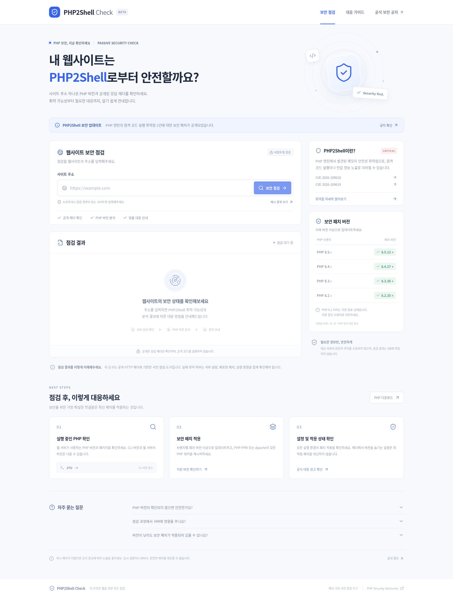
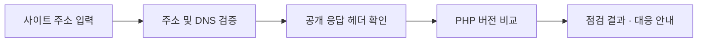

<div align="center">


# PHP2Shell Check

**사이트 주소 하나로 시작하는 PHP 보안 점검.**

공개 응답 헤더와 PHP 버전을 분석하고,<br />
PHP2Shell 취약 가능성부터 필요한 대응까지 한 화면에서 확인하세요.

[](https://nextjs.org/)
[](https://www.typescriptlang.org/)
[](https://nodejs.org/)


[빠른 시작](#quick-start) · [주요 기능](#features) · [결과 해석](#results) · [배포](#deployment) · [보안 권고](#advisories)

</div>

---

PHP2Shell Check는 웹사이트 운영자와 개발자를 위한 **비침투형 PHP 사전 점검 도구**입니다. 대상 사이트에 일반 HTTP 요청을 보내 공개된 PHP 정보를 확인하고, 공식 보안 권고의 패치 버전과 비교해 다음 조치를 안내합니다.

> **공개 헤더를 통한 사전 점검입니다.** 공격 코드나 취약점 재현 요청을 실행하지 않습니다. PHP 버전 미노출은 안전함을 의미하지 않으며, 실제 취약 여부와 배포판 백포트 패치는 서버에서 확인해야 합니다.

<a id="quick-start"></a>

## Quick start

**필수 환경:** Node.js 20.9 이상, npm.

```bash
git clone https://github.com/dhje0ng/php2shell.git
cd php2shell
npm ci
npm run dev
```

[http://localhost:3000](http://localhost:3000)을 열고 사이트 주소를 입력한 뒤 **보안 점검**을 누르세요. `example.com`처럼 프로토콜 없이 입력하면 HTTPS로 점검합니다.

실제 요청 없이 화면을 먼저 살펴보려면 **예시 결과 보기**를 선택하세요. 예시 결과에는 별도 표시가 붙습니다.

<a id="features"></a>

## What can you do with PHP2Shell Check?

| 기능 | 설명 |
| --- | --- |
| **웹사이트 사전 점검** | 공개 HTTP 헤더에서 PHP 버전과 웹 서버 정보를 확인합니다. |
| **패치 버전 비교** | PHP 브랜치별 패치 기준에 따라 취약 가능성·패치 버전 확인·판단 불가를 구분합니다. |
| **응답 헤더 분석** | 최종 응답의 공개 헤더를 확인하고 클립보드로 복사합니다. |
| **대응 방법 안내** | 점검 결과에 맞는 업데이트·패키지 확인·워커 재시작 방법을 안내합니다. |
| **결과 내보내기** | 점검 정보와 참고 자료를 JSON 보고서로 다운로드합니다. |
| **반응형 웹 인터페이스** | 데스크톱과 모바일에서 한국어로 점검하고 결과를 확인합니다. |

### See it in action

주소 입력, 점검 결과, 패치 버전과 대응 가이드를 한 화면에 담았습니다.



## Why PHP2Shell Check?

- **결과에서 다음 행동까지.** 버전 정보와 함께 확인해야 할 항목, 업데이트 기준, 공식 권고를 제공합니다.
- **낮은 요청 부담.** HEAD 요청을 우선 사용하고, 지원하지 않는 서버에서는 GET 응답 헤더를 확인한 뒤 본문 수신을 중단합니다.
- **명확한 판단 범위.** 정보가 부족한 경우 `unknown`으로 표시하며, 버전 문자열과 실제 패치 상태의 차이를 안내합니다.
- **필요한 정보만 수집.** 쿠키 등 민감한 헤더와 응답 본문을 수집하지 않고, 결과를 DB에 저장하지 않습니다.
- **직접 운영하는 점검 도구.** 별도 외부 분석 서비스의 API 키 없이 자신의 Node.js 환경에서 실행할 수 있습니다.

## How it works



1. **대상 검증:** HTTP/HTTPS 주소와 기본 웹 포트만 허용하고, 내부·루프백·예약 IP 주소를 차단합니다.
2. **응답 확인:** DNS 응답을 검증한 뒤 연결 주소를 고정합니다. HEAD 요청이 `405` 또는 `501`이면 GET으로 전환합니다.
3. **리디렉션 처리:** 최대 3회 따라가며 각 목적지를 다시 검증합니다.
4. **버전 분석:** 공개된 PHP 버전을 브랜치별 공식 패치 기준과 비교합니다.
5. **결과 제공:** 최종 URL, 응답 상태, 공개 헤더, PHP 버전, 요청 소요 시간과 대응 방법을 표시합니다.

전체 점검 제한 시간은 **12초**, 개별 요청의 소켓 비활성 제한 시간은 **8초**입니다.

<a id="results"></a>

## Understanding your results

| 결과 | 의미 | 권장 조치 |
| --- | --- | --- |
| **취약 가능성** · `risk` | 노출된 버전이 패치 기준보다 낮거나, 영향 범위에 포함된 지원 종료 버전입니다. | 공급업체의 백포트 여부를 확인하고 보안 패치를 적용하세요. |
| **패치 버전 확인** · `patched` | 노출된 버전이 해당 브랜치의 패치 버전 이상입니다. | 실제 웹 서버의 PHP 패키지와 모든 워커에 패치가 적용되었는지 확인하세요. |
| **판단 불가** · `unknown` | 버전 미노출, 부분 버전, 사전 릴리스 또는 현재 확인 범위 밖의 버전입니다. | 서버에서 실행 중인 PHP 패키지와 보안 패치 이력을 직접 확인하세요. |

헤더는 CDN·프록시에서 변경되거나 실제 엔진과 다를 수 있습니다. 배포판은 버전 번호를 유지하면서 패치를 백포트할 수 있으므로, 이 결과만으로 공격 가능성이나 서버 전체의 안전성을 확정할 수 없습니다.

### Patch reference

**판정 기준일: 2026-10-22.** 아래는 현재 코드에 반영된 PHP 공식 보안 권고의 패치 버전입니다. 기준은 자동 갱신되지 않습니다.

| PHP 브랜치 | 패치 버전 |
| --- | --- |
| 8.5 | **8.5.12 이상** |
| 8.4 | **8.4.27 이상** |
| 8.3 | **8.3.36 이상** |
| 8.2 | **8.2.35 이상** |

PHP 8.1 이하는 공식 지원이 종료되었습니다. 지원 중인 브랜치로 이전하거나 공급업체의 보안 패치 제공 여부를 확인하세요. PHP2Shell의 공개 영향 범위는 PHP 5.4 이상이며, 그 이전 버전은 이 도구에서 `unknown`으로 처리합니다.

<a id="deployment"></a>

## Deployment

Node.js 서버를 지원하는 환경에서 빌드하고 실행하세요.

```bash
npm ci
npm run build
npm start
```

기본 포트는 `3000`입니다. 다른 포트를 사용하려면 다음과 같이 실행할 수 있습니다.

```bash
npm start -- --port 8080
```

실제 점검은 서버의 `POST /api/check`에서 실행되므로 **정적 파일 호스팅만으로는 동작하지 않습니다.** 실행 환경은 대상 사이트에 대한 DNS 조회와 HTTP/HTTPS 연결이 가능해야 합니다. 현재 점검 클라이언트는 HTTP 프록시 환경 변수를 자동 적용하지 않습니다.

인터넷에 서비스를 공개할 때는 배포 환경에서 HTTPS, 요청량 제한, 동시 실행 제한을 설정하세요. 입력한 URL과 응답 헤더에는 정보가 포함될 수 있으므로 인프라의 로그 보관 정책도 확인하세요.

## Development

| 명령어 | 용도 |
| --- | --- |
| `npm run dev` | 개발 서버 실행 |
| `npm test` | 버전 경계·PHP 정보 추출·대상 주소 검증 테스트 |
| `npm run typecheck` | TypeScript 타입 검사 |
| `npm run build` | 프로덕션 빌드 |
| `npm start` | 프로덕션 서버 실행 |

주요 구현은 다음 파일에서 확인할 수 있습니다.

- [`app/page.tsx`](app/page.tsx) — 점검 화면, 결과 탭, 보고서 다운로드.
- [`app/api/check/route.ts`](app/api/check/route.ts) — 서버 요청, DNS 검증, 리디렉션 처리.
- [`lib/assessment.ts`](lib/assessment.ts) — PHP 버전 추출과 패치 기준 판정.
- [`lib/target.ts`](lib/target.ts) — 대상 URL과 IP 주소 검증.

## FAQ

<details>
<summary><strong>PHP 버전이 표시되지 않으면 어떻게 해야 하나요?</strong></summary>

버전 정보가 숨겨져 있거나 CDN·프록시가 헤더를 제거했을 수 있습니다. 웹 요청을 처리하는 PHP 패키지와 보안 패치 적용 여부를 서버에서 확인하세요. CLI의 `php -v` 결과는 웹 서버의 실행 버전과 다를 수 있습니다.

</details>

<details>
<summary><strong>낮은 버전인데도 패치가 적용되어 있을 수 있나요?</strong></summary>

네. 운영체제 배포판이나 호스팅 업체가 버전 번호를 유지한 채 보안 패치를 백포트할 수 있습니다. 패키지의 전체 릴리스 번호와 공급업체 보안 공지를 함께 확인하세요.

</details>

<details>
<summary><strong>서버에서 코드를 실행하거나 공격을 재현하나요?</strong></summary>

아닙니다. 일반 HTTP 요청으로 공개 응답 헤더만 확인합니다. 취약점 재현용 요청이나 공격 코드를 전송하지 않습니다. 본인이 소유하거나 점검 권한이 있는 사이트에 사용하세요.

</details>

<details>
<summary><strong>WAF나 헤더 숨김 설정만으로 해결할 수 있나요?</strong></summary>

PHP 보안 패치를 적용하는 것이 우선입니다. 헤더 숨김은 취약점을 제거하지 않으며, WAF와 임시 설정은 완전한 패치를 대신하지 않습니다. 패치 적용이 어렵다면 아래 공식 권고에 따라 노출을 줄이세요.

</details>

<a id="advisories"></a>

## Security advisories

PHP2Shell은 PHP 엔진의 메모리 안전성과 관련된 다음 두 취약점을 가리킵니다.

- [CVE-2026-109618 — RCE via OOM corruption](https://github.com/php/php-src/security/advisories/GHSA-w8hw-w9fx-j79w)
- [CVE-2026-109619 — RCE via stale global state](https://github.com/php/php-src/security/advisories/GHSA-6wmf-4rv5-p3rp)
- [PHP 공식 다운로드](https://www.php.net/downloads)

## Contributing

개선 제안과 버그 제보는 [Issues](https://github.com/dhje0ng/php2shell/issues)에, 코드 변경은 [Pull requests](https://github.com/dhje0ng/php2shell/pulls)에 남겨주세요. 버전 판정이나 대상 검증 로직을 변경할 때는 관련 테스트도 함께 업데이트해주세요. 제보에 인증 정보나 민감한 서버 정보를 포함하지 마세요.

---

<div align="center">

**더 안전한 웹을 위한 작은 점검.**<br />
PHP2Shell Check · Built with Next.js, React & TypeScript

</div>
